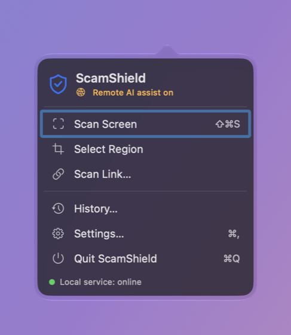
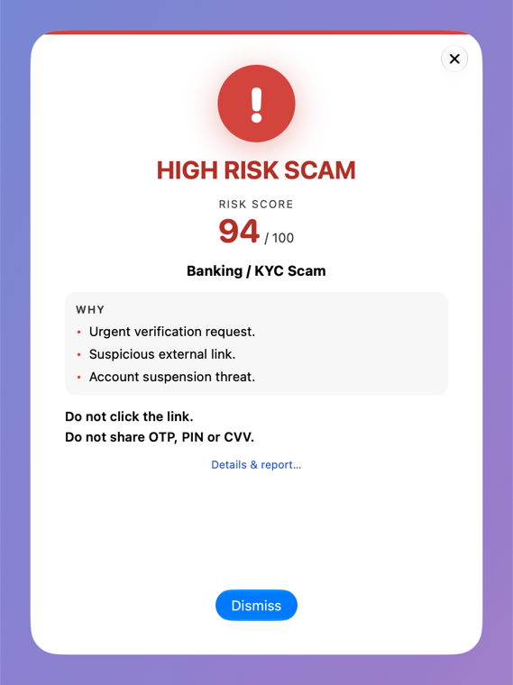
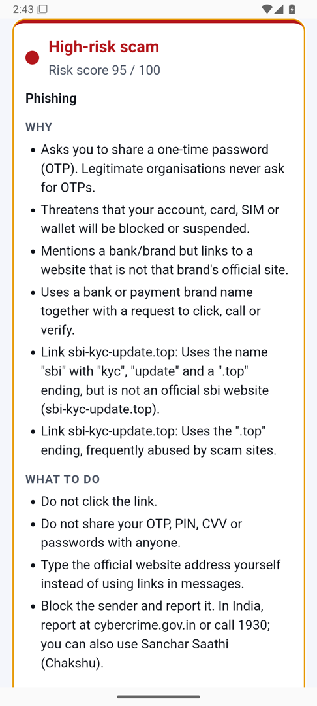
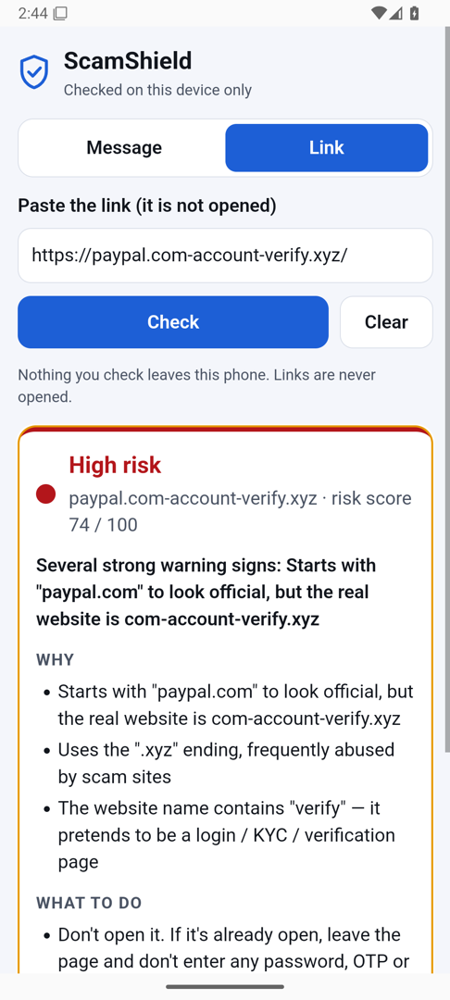

# ScamShield

**Know before you click.** ScamShield checks a suspicious message or link on your own device and
tells you, in plain language, whether it looks like a scam — and why.

[Download](#download) · [How it works](docs/how-it-works.md) · [User guide](docs/guides/user-guide.md) ·
[Security](SECURITY.md) · [Contribute](CONTRIBUTING.md)

<table>
<tr>
<td align="center" width="38%"> macOS (built-in sample result)</td>
<td align="center" width="31%"> Android: a shared SMS</td>
<td align="center" width="31%"> Android: a look-alike link</td>
</tr>
</table>

## What it does

- **Checks messages and links** — scan the screen (macOS), share or paste (Android), or check a link
  without opening it.
- **Explains its answer** — each warning sign it found, and what to do next.
- **Runs on your device** — safety rules, link analysis and an ML model work offline. An AI second
  opinion is optional on macOS and off until you agree; the Android app has no internet permission.
- **Never pretends** — if a check fails you see *Unable to assess*, not "safe".

> [!NOTE]
> No detector can guarantee that a message or link is safe. Accuracy has been measured only on test
> sets written for this project — see [how it works](docs/how-it-works.md).

## Download

**No release has been published yet**, so there are no downloads today. Releases will appear on the
[Releases page](https://github.com/naveennt-dev/ScamShield/releases) with SHA-256 checksums.

| Platform | Status |
|---|---|
| macOS 14+ (Apple silicon) | Built and tested; awaiting release (not yet notarized by Apple) |
| Android 7.0+ | Test build, emulator-tested; awaiting release signing |
| Chrome / Edge extension | Works locally with the macOS app; not in a web store |
| Windows · Linux · iPhone/iPad | Planned — not available yet |

Want to try it now? [Build from source](docs/guides/user-guide.md#build-from-source).

## Privacy

What you scan stays on your device. Screenshots are read and discarded; History (macOS) masks
numbers, e-mail addresses and link paths. The optional AI second opinion receives only masked text,
using your own key. Details: [user guide → privacy](docs/guides/user-guide.md#privacy-and-data) and the
[draft privacy notice](docs/release/PRIVACY-NOTICE-DRAFT.md) (not yet legally reviewed).

## Documentation

[User guide](docs/guides/user-guide.md) · [macOS install](docs/guides/install-macos.md) ·
[Android](docs/guides/android.md) · [How it works](docs/how-it-works.md) ·
[Development](docs/development.md) · [API](docs/api/endpoints.md) · [Changelog](CHANGELOG.md)

## Contributing and security

Contributions are welcome — see [CONTRIBUTING.md](CONTRIBUTING.md) and the
[Code of Conduct](CODE_OF_CONDUCT.md). Report vulnerabilities **privately** via [SECURITY.md](SECURITY.md).
Never post real messages, OTPs, passwords or API keys in issues.

Uses the SMS Spam Collection (Almeida & Gómez Hidalgo, UCI,
[doi:10.24432/C5CC84](https://doi.org/10.24432/C5CC84), CC BY 4.0) and the open-source components in
[THIRD_PARTY_NOTICES](docs/release/THIRD_PARTY_NOTICES.md).

## License

Apache License 2.0 — see [`LICENSE`](LICENSE) and [`NOTICE`](NOTICE). The ScamShield name and logo
are not covered by the licence; see [`TRADEMARKS.md`](TRADEMARKS.md).
