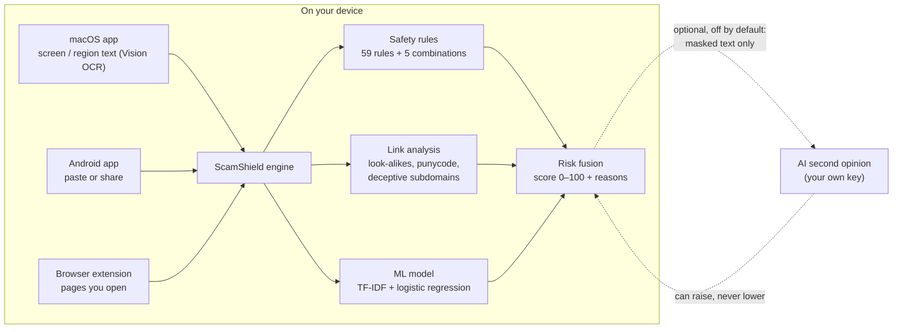

# ScamShield

**Check a suspicious message or link before you act on it — on your own device.**

ScamShield reads a message, screenshot or link and tells you in plain language whether it looks
like a scam, **why**, and what to do next. Checks run locally; nothing is uploaded unless you turn on
the optional AI second opinion.

[Download](#download) · [Features](#features) · [How it works](#how-it-works) ·
[User guide](docs/guides/user-guide.md) · [Security](SECURITY.md) · [Contributing](CONTRIBUTING.md)

> [!IMPORTANT]
> **Preview — no release has been published yet.** The macOS app and an Android test build exist
> and have been tested by the maintainer, but there are no public downloads yet.
> **No detector can guarantee that a message or link is safe.** ScamShield is a second pair of eyes,
> not a guarantee.

## Download

| Platform | Availability | Requirements | Build |
|---|---|---|---|
| **macOS** | Built and tested — **not yet released** | Apple silicon (M1 or later), macOS 14 Sonoma or later | DMG; not notarized by Apple yet |
| **Android** | Test build only — **not yet released** | Android 7.0 or later | Debug APK; release signing and Google Play pending |
| **Browser extension** (Chromium) | Works locally with the macOS app — **not in a web store** | Chrome or Edge + the macOS app | Unpacked extension |
| **Windows** | Planned — not available yet | — | — |
| **Linux desktop** | Planned — not available yet | — | — |
| **iPhone / iPad** | Planned — not available yet | — | — |

When a release is published it will appear on the **[Releases page](https://github.com/naveennt-dev/ScamShield/releases)**
with SHA-256 checksums, and the [downloads page](docs/site/) will enable its download button.
Until then you can build the apps from source — see the [user guide](docs/guides/user-guide.md#build-from-source).

## Features

| | macOS app | Android app |
|---|---|---|
| Check a pasted or shared message | Scan Screen / Select Region (text read on the device) | Paste, or **Share → Check with ScamShield** from any app |
| Check a link without opening it | Scan Link… | Link tab (or share a link) |
| Explains *why* (each warning sign) and *what to do* | ✓ | ✓ |
| "Unable to assess" instead of a false "safe" when a check fails | ✓ | ✓ |
| Works offline, on the device | ✓ (bundled engine) | ✓ (no internet permission at all) |
| Optional AI second opinion (masked text only, your own key) | ✓ — off until you agree | — |
| History of your scans (on the device, numbers masked) | ✓ | — |
| Light and dark mode | ✓ (Liquid Glass on macOS 26+) | ✓ |

<table>
<tr>
<td align="center"> macOS — high-risk result (built-in sample)</td>
<td align="center"> Android — a shared SMS</td>
<td align="center"> Android — a look-alike link</td>
</tr>
</table>

## How it works

1. **Safety rules** (59 rules across 18 scam families, plus 5 combination rules) look for what scams
   need you to do: share an OTP/PIN/CVV or password, pay a
   fee, "update KYC", install an app, give remote access, react to a threat ("account blocked
   today"), claim a prize or refund, take a job or investment offer — in English, Hindi and Hinglish.
2. **Link analysis** checks every web address: look-alike brand names (`amaz0n`, `paypa1`),
   official names placed in front of another site (`paypal.com-account-verify.xyz`), international
   look-alike characters (punycode), shorteners, risky endings and downloads. Links are analysed by
   their address — the app does not open them.
3. **An on-device ML model** (TF-IDF + logistic regression, trained on 3,771 messages from the public
   UCI SMS Spam Collection plus hand-written examples) estimates how scam-like the wording is.
4. **Risk fusion** combines them into one score with explicit safety guards: a clear rule or link
   finding can't be argued away by the model; the model alone can raise a *Suspicious* warning but
   not a *High risk* alarm; the optional AI can raise the score but never lower the on-device result.
   If a check fails, the result is **Unable to assess**, never "safe".

**Risk levels:** `0–29` no scam signs found · `30–59` suspicious · `60–84` high risk · `85–100`
high-risk scam. Links get a verdict: *no known threat*, *suspicious*, *high risk*, *malicious* or
*inconclusive*.

**Measured accuracy** — on test sets written for this project, not real-world traffic: 50/50 scams
caught with 1/50 false alarm (blind set), 68/69 with 5/59 (held-out), 28/28 with 0/22 (realistic);
look-alike links: 100% precision, 90–96% recall at "high risk". Details:
[`docs/ml/evaluation.md`](docs/ml/evaluation.md). Real-world accuracy will be lower.

### Example

You receive: *"Dear SBI customer, your account will be blocked today. Update KYC now at*
`http://sbi-kyc-update.top/login` *and share the OTP to avoid suspension."* — share it to ScamShield:

| ScamShield shows | Meaning |
|---|---|
| **High-risk scam · 95/100 · Phishing** | Several strong, independent warning signs |
| Asks you to share a one-time password (OTP) | Banks never ask for OTPs |
| Threatens that your account will be blocked | Pressure to act before thinking |
| `sbi-kyc-update.top` is not an official SBI website | The link imitates the bank |
| **What to do:** don't click; don't share OTP/PIN/CVV; type the official address yourself; report it (India: cybercrime.gov.in or 1930) | |

## Getting started

- **macOS** — [install guide](docs/guides/install-macos.md): open the DMG, drag ScamShield to
  Applications, choose *on this device only* or *+ AI second opinion*, then use the shield in the
  menu bar (⇧⌘S scans the screen).
- **Android** — [Android guide](docs/guides/android.md): install the test APK, then share a message
  to ScamShield or paste it.
- **Everything else** — scanning, understanding results, privacy, troubleshooting, uninstalling:
  the **[user guide](docs/guides/user-guide.md)**.

## Privacy

- Messages, screenshots and History stay on your device. Screenshots are read and discarded, never
  saved. History masks numbers, e-mail addresses, UPI IDs and link paths.
- The AI second opinion is **off until you agree** and needs your own key; it then receives only
  masked text (or, for links, the address and the findings).
- The Android app has **no internet permission** — Android itself prevents it from sending data.
- Draft privacy notice: [`docs/release/PRIVACY-NOTICE-DRAFT.md`](docs/release/PRIVACY-NOTICE-DRAFT.md)
  (not yet legally reviewed).

## Limitations

- Not 100% accurate: new scam styles, images without text, voice calls and very short messages can be
  missed; genuine messages can occasionally be flagged.
- The macOS app is not yet notarized by Apple; Windows, Linux desktop and iOS apps don't exist yet.
- The Android app has been tested on an emulator (Android 15), not yet on physical phones.

## FAQ

**Does ScamShield read my messages automatically?** No. It only checks what you scan, paste or share.

**Does it need the internet?** No for the on-device checks. On macOS, only the opt-in mode
"On this device + AI second opinion" uses the network — for the AI second opinion and for online link
checks (the website is contacted without your cookies or accounts). The Android app never does.

**Is a "No scam signs found" result a guarantee?** No. It means none of the checks found warning
signs. When in doubt, contact the organisation using a number you already know.

## Documentation

[User guide](docs/guides/user-guide.md) · [macOS install](docs/guides/install-macos.md) ·
[Android](docs/guides/android.md) · [Development](docs/development.md) ·
[API](docs/api/endpoints.md) · [ML evaluation](docs/ml/evaluation.md) ·
[Link protection design](docs/design/link-protection.md) · [Changelog](CHANGELOG.md)

## Contributing and security

Contributions are welcome — see [CONTRIBUTING.md](CONTRIBUTING.md) and the
[Code of Conduct](CODE_OF_CONDUCT.md). Please report vulnerabilities **privately** as described in
[SECURITY.md](SECURITY.md). Never post real messages, OTPs, passwords or API keys in issues.

## Acknowledgements

- SMS Spam Collection — T. Almeida and J. Gómez Hidalgo, UCI Machine Learning Repository
  ([doi:10.24432/C5CC84](https://doi.org/10.24432/C5CC84)), CC BY 4.0.
- Open-source components listed in [`docs/release/THIRD_PARTY_NOTICES.md`](docs/release/THIRD_PARTY_NOTICES.md).

## License

Apache License 2.0 — see [`LICENSE`](LICENSE) and [`NOTICE`](NOTICE). The ScamShield name and logo
are not covered by the licence; see [`TRADEMARKS.md`](TRADEMARKS.md).
