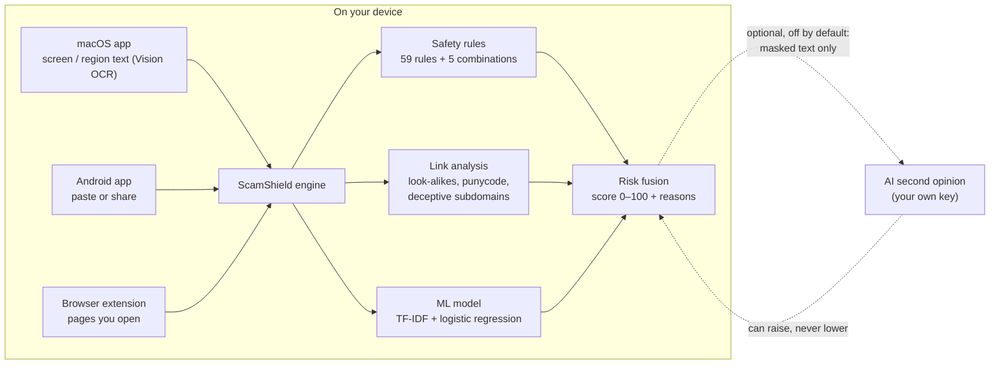

# How ScamShield works

1. **Safety rules** (59 rules across 18 scam families, plus 5 combination rules) look for what scams
   need you to do: share an OTP/PIN/CVV or password, pay a
   fee, "update KYC", install an app, give remote access, react to a threat ("account blocked
   today"), claim a prize or refund, take a job or investment offer — in English, Hindi and Hinglish.
2. **Link analysis** checks every web address: look-alike brand names (`amaz0n`, `paypa1`),
   official names placed in front of another site (`paypal.com-account-verify.xyz`), international
   look-alike characters (punycode), shorteners, risky endings and downloads. Links are analysed by
   their address — the app does not open them.
3. **An on-device ML model** (TF-IDF + logistic regression, trained on 3,771 messages from the public
   UCI SMS Spam Collection plus hand-written examples) estimates how scam-like the wording is.
4. **Risk fusion** combines them into one score with explicit safety guards: a clear rule or link
   finding can't be argued away by the model; the model alone can raise a *Suspicious* warning but
   not a *High risk* alarm; the optional AI can raise the score but never lower the on-device result.
   If a check fails, the result is **Unable to assess**, never "safe".

**Risk levels:** `0–29` no scam signs found · `30–59` suspicious · `60–84` high risk · `85–100`
high-risk scam. Links get a verdict: *no known threat*, *suspicious*, *high risk*, *malicious* or
*inconclusive*.

**Measured accuracy** — on test sets written for this project, not real-world traffic: 50/50 scams
caught with 1/50 false alarm (blind set), 68/69 with 5/59 (held-out), 28/28 with 0/22 (realistic);
look-alike links: 100% precision, 90–96% recall at "high risk". Details:
[`docs/ml/evaluation.md`](ml/evaluation.md). Real-world accuracy will be lower.

## Example

You receive: *"Dear SBI customer, your account will be blocked today. Update KYC now at*
`http://sbi-kyc-update.top/login` *and share the OTP to avoid suspension."* — share it to ScamShield:

| ScamShield shows | Meaning |
|---|---|
| **High-risk scam · 95/100 · Phishing** | Several strong, independent warning signs |
| Asks you to share a one-time password (OTP) | Banks never ask for OTPs |
| Threatens that your account will be blocked | Pressure to act before thinking |
| `sbi-kyc-update.top` is not an official SBI website | The link imitates the bank |
| **What to do:** don't click; don't share OTP/PIN/CVV; type the official address yourself; report it (India: cybercrime.gov.in or 1930) | |

See also: [user guide](guides/user-guide.md) · [link protection design](design/link-protection.md) · [risk engine source](../src/lib/detection/risk-engine.ts)
